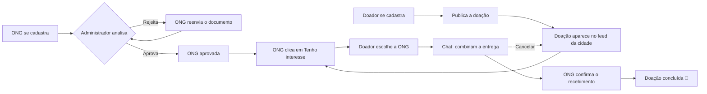
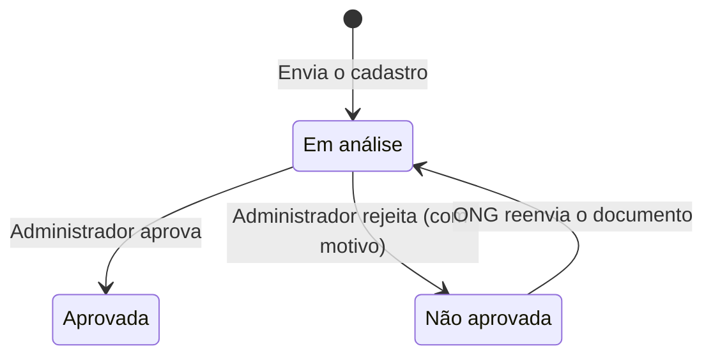
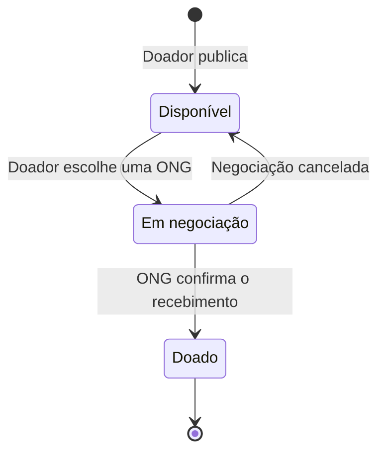
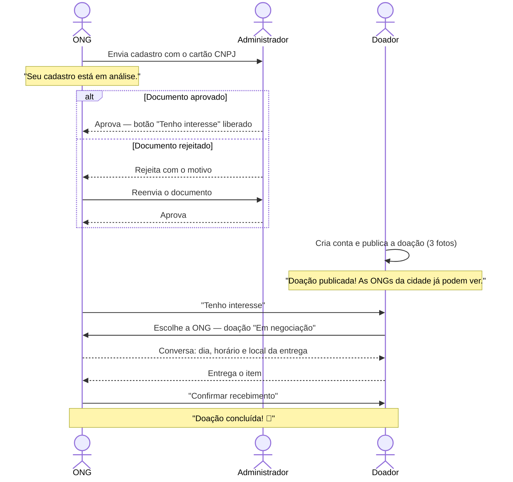
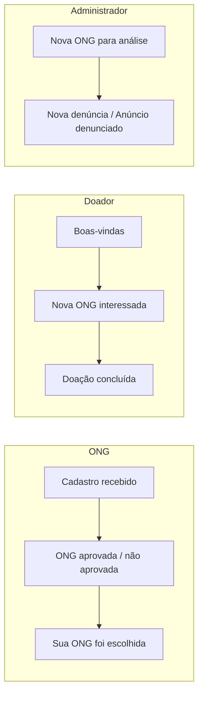

# Conecta Doações — Fluxo do sistema (visão das telas)

> Material de apoio para os slides da apresentação. Conta a jornada completa **do ponto de vista de quem usa o app**: as telas, os botões e as mensagens que aparecem. Os textos entre aspas são os mesmos que aparecem no app.

---

## 1. Visão geral

O Conecta Doações liga **quem quer doar** às **ONGs da mesma cidade**. O doador publica o item, as ONGs demonstram interesse, o doador escolhe uma, os dois combinam a entrega pelo chat e a ONG confirma quando recebe.

### Os três perfis

| Perfil | Quem é | O que faz no app |
|---|---|---|
| **Doador** | Qualquer pessoa | Publica doações, escolhe a ONG, conversa e acompanha a entrega |
| **ONG** | Instituição com CNPJ | Navega pelas doações da cidade, demonstra interesse, conversa e confirma o recebimento |
| **Administrador** | Equipe do Conecta Doações | Aprova ou rejeita ONGs e analisa denúncias |

### Menu de cada perfil

- **Doador e ONG:** Feed · Doações · Conversas · Perfil
- **Administrador:** ONGs · Denúncias
- **Visitante (sem login):** vê o feed de doações de todas as cidades e o detalhe dos itens; para interagir, o app pede "Entre para continuar".

### A jornada em um diagrama

---

## 2. As situações que aparecem nas telas

### Situação da ONG

### Situação da doação

---

## 3. Etapa 1 — A ONG se cadastra e o administrador aprova ou rejeita

### 3.1 Cadastro da ONG

**Quem:** ONG · **Tela:** Criar conta → aba **"Sou uma ONG"**

- Texto de apoio: "Encontre doações na sua cidade. Seu cadastro passa por uma análise rápida."
- Preenche: **Nome da ONG, E-mail, Senha, UF, Cidade, CNPJ, Site (opcional)**.
- Anexa o **Documento da ONG**: "Cartão CNPJ em PDF, JPG, PNG ou WEBP, até 5 MB." (arrasta o arquivo ou clica para escolher).
- A senha mostra as regras ao vivo: de 8 a 72 caracteres, ao menos 1 letra e 1 número.
- Botão **"Enviar cadastro"**.

### 3.2 Cadastro recebido

**Quem:** ONG · **Tela:** Cadastro recebido!

- "Vamos conferir o documento da {ONG}. Enquanto isso, você já pode ver as doações da sua cidade. O botão "Tenho interesse" aparece assim que a ONG for aprovada."
- Botão **"Ver o feed"**.
- Enquanto espera, um aviso fica no topo do app: **"Seu cadastro está em análise."** No Perfil: "A análise costuma levar até 2 dias úteis."
- 📧 **E-mail:** a ONG recebe "Cadastro recebido", e cada administrador recebe "Nova ONG para análise".

### 3.3 Análise pelo administrador

**Quem:** Administrador · **Tela:** Moderação de ONGs

- Abas: **Em análise · Aprovadas · Rejeitadas**.
- Tabela com ONG, cidade, CNPJ e data de cadastro; botão **"Analisar"**.
- A janela de análise mostra o **documento enviado** (dá para abrir em nova aba) e os **dados da ONG** (e-mail, cidade, CNPJ, site).

**Caminho A — Aprovar**

- Botão **"Aprovar"** → confirmação: "A ONG passa a poder demonstrar interesse nas doações da cidade dela."
- Mensagem: **"{ONG} aprovada."**
- Para a ONG: o aviso do topo some e o botão **"Tenho interesse"** passa a aparecer no feed.
- 📧 **E-mail:** a ONG recebe "ONG aprovada", com o link para ver as doações.

**Caminho B — Rejeitar**

- Botão **"Rejeitar"** → o administrador escolhe um motivo pronto ou escreve o seu (mínimo de 10 caracteres). Motivos prontos:
  - **Ilegível** — "O documento está ilegível. Envie uma cópia mais nítida do cartão CNPJ."
  - **CNPJ não confere** — "O CNPJ do documento não confere com o informado no cadastro."
  - **Outra entidade** — "O documento é de outra entidade. Envie o cartão CNPJ da própria ONG."
  - **Vencido ou incompleto** — "O documento está vencido ou incompleto. Envie a versão atual e completa."
- Mensagem: **"{ONG} rejeitada. A ONG vai ver o motivo."**
- Para a ONG: aviso no topo **"Cadastro não aprovado: {motivo}"** com o botão **"Reenviar documento"**. Ao reenviar: "Documento enviado. A ONG volta para análise." — e o ciclo recomeça.
- 📧 **E-mail:** a ONG recebe "Cadastro não aprovado" com o motivo e o link para reenviar. Quando ela reenvia, os administradores recebem "Documento reenviado".

> **Slide sugerido:** "Cadastro da ONG com análise" — print da tela de cadastro + print da janela de análise do admin, com as duas setas (Aprovar / Rejeitar → reenviar).

---

## 4. Etapa 2 — O doador se cadastra e publica uma doação

### 4.1 Cadastro do doador

**Quem:** Doador · **Tela:** Criar conta → aba **"Quero doar"**

- Texto de apoio: "Publique o que você não usa mais e escolha a ONG que vai receber."
- Preenche nome, e-mail, senha, UF e cidade → **"Criar conta"**.
- **Não passa por análise:** já entra no app e pode publicar.
- 📧 **E-mail:** "Boas-vindas", com o link para publicar a primeira doação.

### 4.2 Nova doação (3 passos)

**Quem:** Doador · **Tela:** Doações → **"Nova doação"**

| Passo | O que o doador faz |
|---|---|
| **1. Fotos** | Envia **exatamente 3 fotos** (JPG, PNG ou WEBP). "A primeira é a capa: arraste ou use as setas para trocar a ordem." Pode editar cada foto: zoom, girar, espelhar. |
| **2. Dados** | **Título** (ex.: "Casaco infantil tamanho 6"), **Categoria** (Roupas, Brinquedos, Alimentos ou Livros), **Descrição** (estado, tamanho, quantidade… opcional) e **Observações do doador** (retirada, horários… só quem está logado vê). |
| **3. Revisar** | "Confira antes de publicar — É assim que as ONGs vão ver a sua doação." e "Será publicada em {cidade} - {UF}, a sua cidade." |

- Botão **"Publicar doação"** → mensagem: **"Doação publicada! As ONGs de {cidade} já podem ver."**
- Se sair no meio do caminho, o app pergunta: "Descartar esta doação?"

### 4.3 Minhas doações

**Quem:** Doador · **Tela:** Doações → **Minhas doações**

- Filtros: **Todas · Disponíveis · Em negociação · Doadas**.
- Cada cartão mostra a situação e quantas ONGs se interessaram: "Nenhuma ONG interessada ainda" ou "Ver 3 ONGs interessadas".

> **Slide sugerido:** "Publicar em 3 passos" — Fotos → Dados → Revisar, com a mensagem de sucesso.

---

## 5. Etapa 3 — A ONG demonstra interesse

### 5.1 Feed

**Quem:** ONG aprovada · **Tela:** Feed

- Mostra as **"Últimas doações"** da cidade da ONG, das mais novas para as mais antigas.
- Busca ("Pesquise um item ou uma palavra-chave") e filtro por **categoria**.
- Dá para trocar a localização: "O feed mostra as doações da sua cidade. Mudou de cidade? Atualize aqui."

### 5.2 Detalhe da doação e interesse

**Quem:** ONG aprovada · **Tela:** Detalhe do item

- Vê as 3 fotos, a descrição, as observações do doador e a data de publicação.
- Botão **"Tenho interesse"** → mensagem: **"Interesse registrado. O doador vai ver a sua ONG na lista."** (com opção **"Desfazer"**).
- O item passa a aparecer em **Doações → Meus interesses** da ONG.
- 📧 **E-mail:** o doador recebe "Nova ONG interessada em {item}", com o link para ver as interessadas.

**Bloqueios que o usuário percebe:**
- ONG em análise ou não aprovada **não vê** o botão "Tenho interesse".
- A ONG só demonstra interesse em doações **da sua cidade**.
- Depois de escolhida pelo doador, a ONG não pode mais desfazer o interesse; a saída é cancelar a negociação.

> **Slide sugerido:** "A ONG encontra a doação" — print do feed + botão "Tenho interesse".

---

## 6. Etapa 4 — O doador escolhe a ONG e os dois conversam

### 6.1 Escolha da ONG

**Quem:** Doador · **Tela:** ONGs interessadas (a partir de Minhas doações → "Ver N ONGs interessadas")

- Cartões das ONGs com nome, **CNPJ**, **site** e há quanto tempo se interessou ("Interessada há 2 horas").
- Botão **"Escolher"** → confirmação:
  > **"Escolher {ONG}?"** — "A doação fica em negociação só com esta ONG e vocês combinam a entrega pela conversa. As outras ONGs deixam de poder ser escolhidas."
- Botão **"Escolher e conversar"** → mensagem: **"{ONG} escolhida. Abrindo a conversa…"**
- A doação muda para **Em negociação**. Para a ONG escolhida, o item aparece como **"Escolhida para você"**.
- 📧 **E-mail:** a ONG recebe "Sua ONG foi escolhida para {item}", com o link direto para a conversa.

### 6.2 Conversa (chat em tempo real)

**Quem:** Doador e ONG escolhida · **Tela:** Conversas

- Abas: **Em andamento · Concluídas**.
- Dica no início: **"Combinem a entrega por aqui: dia, horário e local."**
- As mensagens chegam na hora, sem recarregar a página. O menu mostra o **contador de mensagens não lidas** e aparece o aviso "Nova mensagem de {nome}".
- No topo da conversa: "Sobre {item}" com o link **"Ver item"**.
- As mensagens **não** geram e-mail: o aviso é só dentro do app, em tempo real.

### 6.3 Ações dentro da conversa

| Ação | Quem | O que acontece |
|---|---|---|
| **Denunciar** | Doador ou ONG | Conta o que aconteceu (10 a 1000 caracteres) → "Denúncia enviada. A equipe vai analisar." A denúncia vai para a tela **Denúncias** do administrador, com a conversa e a linha do tempo do item. |
| **Cancelar negociação** | Doador ou ONG | "O item volta para o feed e esta conversa é encerrada." Motivo opcional, que a outra parte vê. O app alerta: "Denuncie antes de cancelar: depois do cancelamento não dá mais para denunciar." |

- Depois de cancelar: o item volta a **Disponível**, a outra parte recebe o aviso "A negociação de {item} foi cancelada pela outra parte." e o doador vê o botão **"Escolher outra ONG"**.
- 📧 **E-mail:** a outra parte recebe "Negociação cancelada", com o motivo, se houver. Cada denúncia também gera um e-mail para os administradores.

> **Slide sugerido:** "Escolha e conversa" — print da lista de ONGs interessadas + print do chat.

---

## 7. Etapa 5 — A ONG confirma o recebimento

**Quem:** ONG escolhida · **Tela:** Conversas (dentro da conversa)

- Depois de receber o item, a ONG toca **"Confirmar recebimento"** → confirmação:
  > **"Confirmar que recebeu {item}?"** — "A doação fica concluída e a conversa passa a ser só leitura. Faça isso depois de receber o item."
- Aparece a comemoração: **"Doação concluída! 🎉** Obrigado por fazer a doação chegar a quem precisa."
- O doador recebe o aviso: **"{item}: a ONG confirmou o recebimento. Doação concluída!"**
- A doação fica **Doado**; a conversa vai para a aba **Concluídas** ("Doação concluída. A conversa fica disponível só para leitura.").
- A doação aparece na **página pessoal** do doador (doações feitas) e da ONG (doações recebidas).
- 📧 **E-mail:** o doador recebe "Doação concluída", com o agradecimento.

> Só a **ONG escolhida** pode confirmar o recebimento: é quem recebeu que diz que recebeu.

> **Slide sugerido:** "Missão cumprida" — print da janela "Doação concluída! 🎉".

---

## 8. A jornada completa em um slide

---

## 9. Regras em destaque (frases prontas para slide)

- Toda ONG passa por **análise do documento** antes de interagir.
- ONG rejeitada **vê o motivo** e pode **reenviar o documento**.
- O doador **não precisa de aprovação**: cadastrou, já pode doar.
- Toda doação tem **3 fotos**, e a primeira é a capa.
- Cada um vê **as doações da própria cidade**; o visitante vê todas.
- O doador escolhe **uma ONG por vez**; as outras ficam aguardando.
- Doador e ONG **combinam a entrega pelo chat**, em tempo real.
- Deu errado? Qualquer um **cancela**, e a doação **volta para o feed**.
- Só a **ONG que recebeu** confirma a doação.
- Problemas na conversa viram **denúncias** para o administrador.
- Cada passo importante também chega **por e-mail**, para ninguém precisar ficar com o app aberto.

---

## 10. Roteiro sugerido de slides

| # | Slide | Seção |
|---|---|---|
| 1 | O problema e a proposta do Conecta Doações | 1 |
| 2 | Os três perfis: Doador, ONG e Administrador | 1 |
| 3 | A jornada completa (diagrama) | 1 ou 8 |
| 4 | Cadastro da ONG | 3.1 e 3.2 |
| 5 | Análise do administrador: aprovar ou rejeitar | 3.3 |
| 6 | Cadastro do doador e nova doação em 3 passos | 4 |
| 7 | Feed e "Tenho interesse" | 5 |
| 8 | Escolha da ONG | 6.1 |
| 9 | Chat, denúncia e cancelamento | 6.2 e 6.3 |
| 10 | Confirmação do recebimento e doação concluída | 7 |
| 11 | Regras do sistema | 9 |
| 12 | E-mails que o sistema envia | 11 |

---

## 11. E-mails que o sistema envia

Além dos avisos dentro do app, cada passo importante da jornada chega por e-mail. Todo e-mail tem um botão que leva direto para a tela certa.

| Quando | Quem recebe | Assunto do e-mail | O botão leva para |
|---|---|---|---|
| ONG envia o cadastro | ONG | Cadastro recebido | Feed |
| ONG envia o cadastro | Administradores | Nova ONG para análise | Moderação de ONGs |
| Administrador aprova | ONG | ONG aprovada | Feed |
| Administrador rejeita | ONG (com o motivo) | Cadastro não aprovado | Perfil (reenviar documento) |
| ONG reenvia o documento | Administradores | Documento reenviado | Moderação de ONGs |
| Doador cria a conta | Doador | Boas-vindas | Nova doação |
| ONG demonstra interesse | Doador | Nova ONG interessada em "{item}" | ONGs interessadas |
| Doador escolhe a ONG | ONG | Sua ONG foi escolhida para "{item}" | Conversa |
| Negociação cancelada | A outra parte (com o motivo) | Negociação cancelada | Minhas doações ou feed |
| ONG confirma o recebimento | Doador | Doação concluída | Nova doação |
| Denúncia na conversa | Administradores | Nova denúncia sobre "{item}" | Denúncia |
| Denúncia de anúncio | Administradores (com o motivo) | Anúncio denunciado: "{item}" (na 3ª pessoa: Anúncio fora do ar por denúncias) | Denúncia |
| Administrador remove o anúncio | Doador (com o motivo) | Anúncio removido: "{item}" | Minhas doações |
| Administrador remove o anúncio em negociação | ONG escolhida | Negociação encerrada: "{item}" | Feed |
| "Esqueci a senha" | A pessoa | Redefinição de senha | Criar nova senha |
| Senha alterada | A pessoa | Sua senha foi alterada | App |
| Conta excluída | A pessoa | Conta excluída | — |

> Mensagens do chat **não** viram e-mail: o app já avisa na hora, e assim ninguém recebe dezenas de e-mails por conversa.

> **Slide sugerido:** "Ninguém fica sem saber" — a tabela acima resumida em três colunas (ONG, Doador, Administrador).

